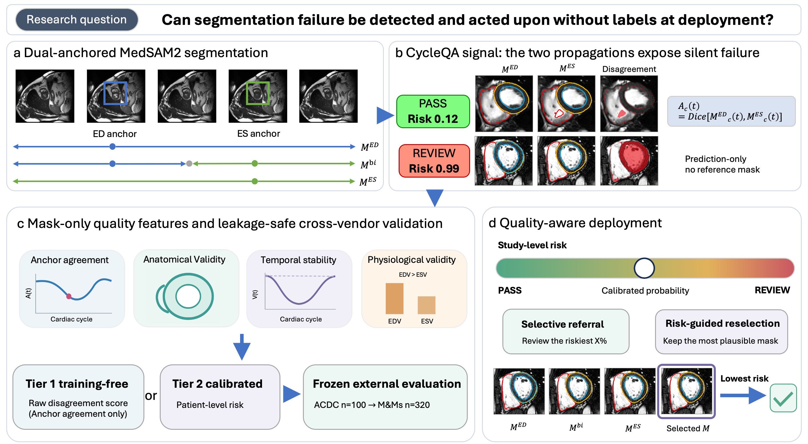

# CycleQA

**Cross-Vendor Quality Assurance of Zero-Shot Full-Cycle 4D Cardiac Cine MRI Segmentation
via Dual-Anchored Medical Video Foundation Model**

Zhuoan Li — MIUA 2026 (MÉTIS Special Session)



Code for every result in the paper: preprocessing → segmentation inference → quality assurance →
figures and tables.

---

## The problem

A medical video foundation model needs no labels to **run** — so it has no labels with which to be
**checked**.

Dual-anchored MedSAM2 segments the full cardiac cycle zero-shot (no training, two box prompts) and
scores **0.913 / 0.801 / 0.858** Dice (RV / Myo / LV) on ACDC. But ACDC is one hospital on **Siemens**
scanners. We evaluated the same fixed system on **320 M&Ms patients** across four manufacturers.

A pooled development-vs-external comparison would confound three changes at once — new dataset, new
centre, new manufacturer — so the external cohort is stratified by manufacturer:

| Cohort | What changed | Mean Dice | **EF error** | **Failed studies** |
|---|---|---|---|---|
| **ACDC** (Siemens) | — (development) | 0.857 | **6.4 pp** | **11 %** |
| **M&Ms Siemens** | new dataset, new centre, **same manufacturer** | 0.817 | **5.7 pp** | 28 % |
| **M&Ms Philips** | **new manufacturer** | 0.705 | **29.0 pp** | 66 % |
| **M&Ms GE** | **new manufacturer** | 0.746 | **32.5 pp** | 58 % |
| **M&Ms Canon** | **new manufacturer** | 0.718 | **33.9 pp** | 70 % |

Dice degrades only modestly (0.86 → 0.70–0.75) — a reader seeing that alone would call the system
"degraded but usable". The ejection fraction computed from *those same masks* is off by up to 34
percentage points. **Dice understates the clinical effect, and at the new site there is no reference
mask with which to notice.**

*("pp" = percentage point. EF is itself a percentage, so an error of "6.4 pp" means the estimate was
6.4 points off; "6.4 %" would ambiguously suggest a relative error.)*

## The idea

Dual anchoring propagates the same video **twice**: once anchored at the end-diastolic frame
(`ed_pred`), once at end-systole (`es_pred`). Each anchor propagates in *both* temporal directions,
so both predictions span every frame of the cycle. Both are already produced by the upstream system.

> If the model tracks the true anatomy, the two independent trajectories converge. If it drifts,
> they separate.

For frame *t* and structure *c*:

```
A_c(t) = Dice( ed_pred[t] , es_pred[t] )          # agreement — no ground truth anywhere
disagreement map = ( ed_pred[t] != es_pred[t] )   # voxels the two passes label differently
```

That is CycleQA. It needs no reference mask, no second network, no ensemble, no registration, no
retraining, and no extra inference. A frame-wise CNN cannot produce this signal at all: with no
temporal propagation there is no second anchor direction to disagree.

## Results

**Estimate segmentation quality with no ground truth and no training:**

| | Pearson *r* | MAE |
|---|---|---|
| ACDC (development) | 0.735 | 0.064 |
| **M&Ms (external)** | **0.814** | **0.072** |

**Detect failed studies.** The risk model is fitted on ACDC with patient-level nested
cross-validation, **frozen**, and applied once to M&Ms — it never sees a Philips, GE or Canon study
during development.

Training-free disagreement: AUROC **0.850** [0.811 – 0.888].
Calibrated model, per manufacturer: Siemens 0.883 · Philips 0.857 · GE 0.823 · **Canon 0.806**.

**It detects the error, not the scanner.** A detector that merely recognises unusual-looking images
could not separate "unusual but correct" from "broken", so each detector is scored against two
different targets:

| | *unseen manufacturer* | *failed segmentation* |
|---|---|---|
| Reads the **image** (appearance OOD) | 0.48 | 0.57 |
| Reads the **mask** (CycleQA) | 0.64 | **0.85** |

**Risk-guided reselection.** Three predictions per patient already exist; which is best is
domain-dependent, and no labels are available to choose. CycleQA scores each and keeps the most
plausible:

| Strategy | Mean Dice | **EF error** | **Failure rate** |
|---|---|---|---|
| Merged output (current system) | 0.747 | **23.4 pp** | **54.4 %** |
| Best fixed choice (*needs labels to identify*) | 0.799 | 16.8 pp | 21.9 % |
| **CycleQA reselection** | **0.815** | **12.0 pp** | **14.7 %** |
| Oracle (upper bound) | 0.812 | 10.4 pp | 17.8 % |

No labels, no retraining, no additional segmentation inference. On Siemens, CycleQA keeps the merged
or ED-anchored output (EF error 5.8 pp) — whereas *always* choosing ES, the best global strategy,
would raise it to 14.8 pp. On the other manufacturers it switches to ES. No fixed strategy works
everywhere, and CycleQA adapts per study without being given the manufacturer.

The segmentation model must read **appearance**, which is what changes between scanners. CycleQA asks
only whether a prediction is self-consistent and anatomically plausible — constraints that hold on
any scanner — which is why it remains informative under a shift that degrades the segmenter.

---

## Reproducing the results

### Requirements

```bash
conda env create -f environment.yml     # or: pip install -r requirements.txt
conda activate cycleqa
```

Python ≥ 3.9 · numpy · scipy · pandas · scikit-learn · matplotlib · nibabel.
PyTorch and the MedSAM2 checkpoint are needed **only** for Stage 2; the quality-assurance stage is
pure CPU.

### Data

Both datasets are public and are **not** redistributed here.

- **ACDC** — Bernard et al. 2018, [`10.1109/TMI.2018.2837502`](https://doi.org/10.1109/TMI.2018.2837502).
  100 patients, 1 centre, Siemens.
- **M&Ms** — Campello et al. 2021, [`10.1109/TMI.2021.3090082`](https://doi.org/10.1109/TMI.2021.3090082).
  320 patients, 4 manufacturers, 5 centres, 9 pathologies.

### Stage 1 — Preprocessing  (`pipeline/`)

```bash
python pipeline/prep_acdc_4d.py --src <ACDC_root>  --out preprocessed
python pipeline/prep_mnm.py     --src <M&Ms_root>  --out preprocessed_mnm
```

Per short-axis slice: extract the 2D+*t* sequence, clip to the 2nd–98th intensity percentile,
normalise to `[0,1]`, resize to 512 × 512, harmonise the label convention, write one NPZ.

> ⚠️ **The raw M&Ms distribution uses the opposite label convention to ACDC** (`1 = LV, 3 = RV`); it
> is remapped here. `src/verify_data.py` re-establishes the convention geometrically rather than
> trusting the remap — the LV is the blood pool whose boundary neighbourhood is almost entirely
> myocardium (measured 1.000 on ACDC, 0.994 on M&Ms for label 3). Getting this wrong is silent: the
> code runs fine and reports nonsense (LV Dice 0.005).

### Stage 2 — Segmentation inference  (`pipeline/`)

```bash
python pipeline/infer_medsam2.py \
    --data preprocessed_mnm --out results/medsam2_mnm \
    --ckpt MedSAM2/checkpoints/MedSAM2_latest.pt \
    --cfg  configs/sam2.1_hiera_t512.yaml \
    --overwrite
```

MedSAM2 is prompted with a bounding box at ED and propagated in both temporal directions to cover
every frame; prompted again at ES and likewise propagated both ways; the two full-length predictions
are then merged, each frame taking the nearer anchor. All three (`ed_pred`, `es_pred`, `bidir`) are
written to disk.

> ⚠️ **`--overwrite` is not optional if any input changed** — without it the script silently skips
> existing outputs and reuses stale predictions.
> ⚠️ MedSAM2/SAM2 resolve their config through Hydra **relative to the working directory**: `--cfg`
> must be a relative path and the process must `chdir` into `MedSAM2/`. The script does this at import.

### Stage 3 — Quality assurance  (`src/`)

**No GPU, no training, no inference** — reads the NPZs from Stage 2. ≈ 20 min on 48 CPU cores.
Run in order; each step consumes the previous step's output, and together they write `results/*.csv`,
from which the figures, the tables and every number in the manuscript are derived.

```bash
python src/verify_data.py        # blocking data gate; exits non-zero on failure
python src/compute_metrics.py    # per-patient reference metrics (the only place GT defines the endpoint)
python src/extract_features.py   # 46 no-reference features + a leakage assertion
python src/variant_features.py   # the same features, per prediction variant
python src/train_qc.py           # nested CV -> frozen -> external; OOD control; risk-coverage; ablation
python src/reselect.py           # risk-guided reselection
python src/make_figures.py       # 5 figures
python src/make_tables.py        # 3 LaTeX tables
python src/verify_numbers.py     # re-derives every manuscript number; non-zero exit on any mismatch
```

`src/verify_data.py` is a blocking gate: it checks the ED/ES indices against the dataset metadata
*per manufacturer*, that EDV > ESV for every patient, that the label convention is consistent, and
that the disagreement signal survives restriction to mid-cycle frames — where neither prediction is
anchored.

### How EF is computed

LV volume at frame *t* is the LV voxel count times the physical voxel volume. Masks are stored at
512 × 512 while `pixdim` is given at the original resolution, so the in-plane spacing is rescaled by
`orig_H/512` and `orig_W/512` first. Then

```
EDV = max(V_ED, V_ES)     ESV = min(V_ED, V_ES)     EF = (EDV − ESV) / EDV × 100
```

`max`/`min` rather than a fixed assignment, because the ED/ES frame *ordering* is not consistent
across manufacturers. The reference EF is computed the same way from the reference masks, which is
how EF is measured clinically from cine CMR (summation of discs). As a check, the ACDC pathology
groups recover their known physiology: DCM 18.4 %, MINF 31.0 %, NOR 60.4 %, HCM 67.4 %.

---

## Repository layout

```
pipeline/   prep_acdc_4d.py     raw 4D cine + ED/ES masks -> 512x512 NPZ; label convention harmonised
            prep_mnm.py         the same, for the multi-vendor cohort
            infer_medsam2.py    dual-anchored propagation -> ed_pred / es_pred / bidir
            infer_sam2.py       the non-medical SAM2 baseline

src/        common.py           shared loaders, geometry, metric primitives
            verify_data.py      the blocking data gate
            compute_metrics.py  reference metrics
            extract_features.py 46 no-reference features + a leakage assertion
            variant_features.py per-variant features, for reselection
            train_qc.py         nested CV -> frozen -> external; OOD control; risk-coverage; ablation
            reselect.py         risk-guided reselection
            make_figures.py     5 figures      make_tables.py   3 LaTeX tables
            verify_numbers.py   every manuscript number, re-derived

docs/       PIPELINE.md         end to end, including how EF is computed
            DATASETS.md         cohorts, label convention, and the verification gate
            MODELS.md           the prediction directories, and what is not included
            SKILLS.md           leakage control, nested CV, calibration, selective prediction
            ENVIRONMENT.md      environment and the traps worth knowing
            RESULTS_SUMMARY.md  every headline number in one place

configs/    cycleqa.yaml        thresholds, CV settings, seeds -- one source of truth
figures/    method.png, fig1..fig5.png
```

Running Stage 3 creates `results/*.csv` (per-patient metrics, features and scores); these are
generated locally and are not distributed. The manuscript source is not included while the paper is
in press.

## Scope

Two points to be aware of when reproducing or reusing these results:

- ED/ES box prompts are derived from the reference masks, so the reported segmentation performance is
  an oracle-prompt upper bound. Automatic prompt generation is out of scope here.
- Reference masks are available only at ED and ES, so evaluation targets annotated-phase error.
  Full-cycle predictions supply the CycleQA features, but intermediate phases are not validated
  targets.

Supervised U-Net and DINOv2 predictions on the external cohort are not included, because their
training-checkpoint provenance could not be established ([`docs/MODELS.md`](docs/MODELS.md)).

## Citation

```bibtex
@inproceedings{li2026cycleqa,
  title     = {Cross-Vendor Quality Assurance of Zero-Shot Full-Cycle 4D Cardiac Cine MRI
               Segmentation via Dual-Anchored Medical Video Foundation Model},
  author    = {Li, Zhuoan},
  booktitle = {Medical Image Understanding and Analysis (MIUA)},
  year      = {2026}
}
```
